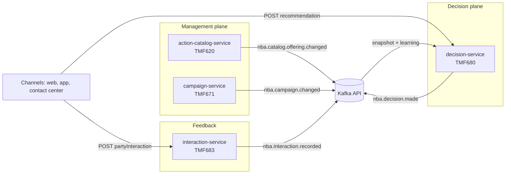

# NBA Platform

An industry-agnostic **Next Best Action** campaign management platform: independently deployable Java 21 /
Spring Boot microservices behind TM Forum Open API contracts, connected by a Kafka-API event backbone, deployable
to any Kubernetes (kind, EKS, OpenShift).

The design rationale is in [docs/research-and-architecture.md](docs/research-and-architecture.md) and the agreed
principles and decisions are in [docs/architecture-principles.md](docs/architecture-principles.md).

## How a decision is made



The decision service runs a pipeline of **plugins** (in-process, swappable, each switchable by property):

| Stage | Core plugin | What it does |
|---|---|---|
| Candidates | `campaign-candidates` | Actions of every active campaign valid now on the request channel |
| Eligibility | `consent`, `eligibility-rules`, `contact-policy`, `control-group` | Opt-out and channel consent, [campaign rules](docs/eligibility-rules.md), daily impression caps, stable hold-out groups for lift measurement |
| Scoring | `logistic-propensity` | Per-offering logistic propensity model over context attributes |
| Learning | `thompson-sampling` | Contextual Thompson sampling: Beta posterior per campaign x offering, prior centred on the model score |
| Arbitration | `priority-pvl` | priority = propensity x value x business lever |
| Selection | `top-n` | Best campaign per offering, top N |

The pipeline runs under a deadline (80 ms default), a per-channel bulkhead and a circuit breaker. If it fails,
times out or the breaker is open, the API still answers with the tenant's configured **safe default** actions and
`fallback: true`. Every decision, including each suppressed candidate and its reason code, is written to the
`nba.decision.made` log.

Adding a strategy (uplift model, RL policy, remote model server) means shipping a jar with a `DecisionStage` bean;
see `services/decision-service/decision-spi`.

## Repository layout

| Path | Contents |
|---|---|
| `contracts/openapi` | OpenAPI 3.1 contracts for each TMF API subset |
| `contracts/asyncapi` | AsyncAPI 3.0 contract for all events (CloudEvents envelope) |
| `libs/event-contracts` | Java bindings for the event contracts |
| `libs/platform-starter` | Cross-cutting only: tenancy, TMF630 errors, JSON Merge Patch, transactional outbox, observability |
| `services/action-catalog-service` | TMF620 ProductOffering (actions) |
| `services/campaign-service` | TMF671 Promotion (campaigns) |
| `services/decision-service` | `decision-spi`, `decision-plugins-core`, `decision-app` (TMF680 Recommendation) |
| `services/interaction-service` | TMF683 PartyInteraction (impressions and responses, idempotent) |
| `deploy` | Docker Compose, Helm charts with kind/EKS/OpenShift overlays, Kafka topics |

## Run it locally

Requires Docker.

```bash
docker compose -f deploy/compose/docker-compose.yml up --build
```

Then create an action and a campaign, ask for a decision and report the response:

```bash
T='X-Tenant-Id: demo'; J='Content-Type: application/json'

OFFER=$(curl -s localhost:8081/tmf-api/productCatalogManagement/v4/productOffering -H "$T" -H "$J" -d '{
  "name":"Premium upgrade","lifecycleStatus":"Active","businessValue":120,"channel":[{"id":"web"}],
  "propensityModel":{"version":"v1","intercept":-2.5,"coefficients":{"tenureMonths":0.04}}}' | jq -r .id)

curl -s localhost:8082/tmf-api/promotionManagement/v4/promotion -H "$T" -H "$J" -d '{
  "name":"Loyal upgrade","lifecycleStatus":"active","channel":[{"id":"web"}],
  "eligibilityRule":"tenureMonths >= 12","controlGroupPercent":5,"maxImpressionsPerDay":3,
  "action":[{"actionObjectId":"'$OFFER'"}]}'

curl -s localhost:8083/tmf-api/recommendationManagement/v4/recommendation -H "$T" -H "$J" -d '{
  "relatedParty":[{"id":"party-42"}],"channel":{"id":"web"},
  "characteristic":[{"name":"tenureMonths","value":24}]}' | jq

curl -s localhost:8084/tmf-api/partyInteractionManagement/v4/partyInteraction -H "$T" -H "$J" \
  -H 'Idempotency-Key: party-42-1' -d '{
  "relatedParty":[{"id":"party-42"}],"channel":[{"id":"web"}],"decisionId":"<recommendation id>",
  "productOffering":{"id":"'$OFFER'"},"outcome":"ACCEPTED"}'
```

## Build and test

```bash
mvn verify
```

Tests use H2 (PostgreSQL mode) and an embedded Kafka broker, so no external services are needed.

## Deploy

See [docs/deployment.md](docs/deployment.md) for kind, Amazon EKS and OpenShift, and for the optional service mesh.

## Known limitations of this first milestone

- **No authentication yet.** The APIs trust the `X-Tenant-Id` header. OAuth2/OIDC with per-tenant scopes is the
  next security step and must be in place before any shared or production deployment.
- Learning statistics and contact history live in each decision replica's memory, rebuilt from events on start.
  This is fine for the MVP; a Redis-compatible store behind the same SPI replaces it at scale.
- The decision log is published asynchronously without an outbox, so a broker outage can lose log entries
  (decisions still succeed).
- OpenAPI/AsyncAPI files are hand-written alongside the code; generated contract tests are not in place yet.
- Feature store, outbound orchestration, uplift models, the constrained optimizer and an admin UI are later phases
  (see the roadmap in the research document).
